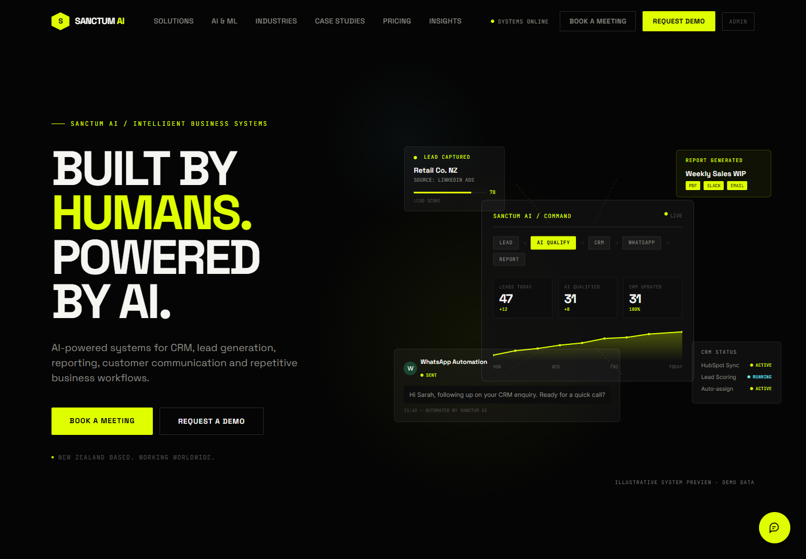
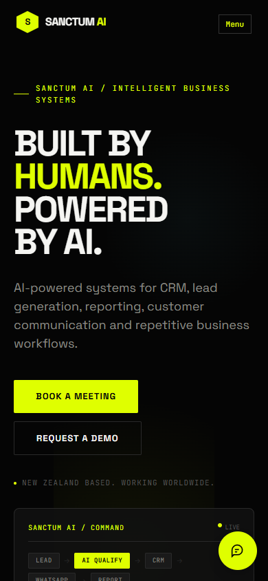
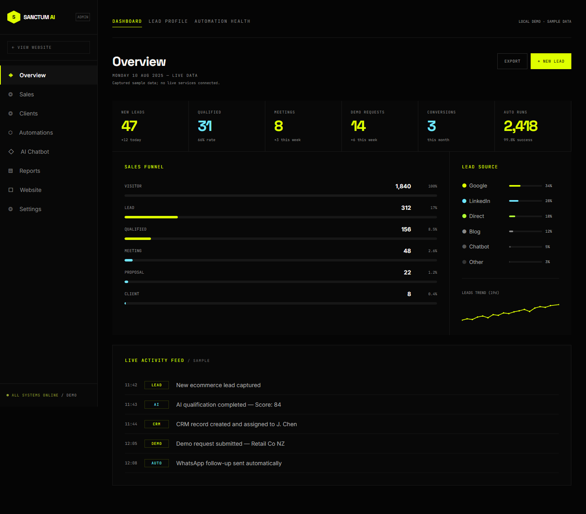

# Sanctum AI

Current version: **1.1.0**. See [release notes](CHANGELOG.md) for additions and setup requirements.

A company website for a New Zealand based business automation service, with a Supabase-backed internal CRM. Sanctum AI presents CRM automation, lead generation, reporting, customer communication, document processing and custom AI services for SMEs and growing businesses worldwide.

The original public design, fonts, sections, calculator, assistant and responsive navigation are preserved. The CRM uses database records and role/assignment-based access; it has no fabricated metric fallback.

**Setup is still required.** The local publishable key is a placeholder. Remote migrations, staff provisioning, Auth/email settings and deployment have not been performed or verified. The exact Next.js 16.4 Cloudflare Worker builds but fails its runtime probe; see the deployment guide before choosing hosting.

## Preview

### Public homepage



### Mobile homepage



### Preserved admin demonstration



The admin image above is the **original sample demo**, now at `/admin/demo`. The secure CRM starts at `/admin/dashboard` and requires an invited, active staff account. No public live-preview URL is configured. Run the app locally to use the public site, enquiry form and staff sign-in. Refresh screenshots with `node tools/capture-preview.mjs` while the server is running.

## Features implemented

| Area                | Implementation                                                                                                                                |
| ------------------- | --------------------------------------------------------------------------------------------------------------------------------------------- |
| Public website      | Existing homepage preserved; invalid SVG JSX properties corrected; enquiry CTAs and `/contact` use validated lead submission                  |
| Supabase            | Reusable browser/server clients, cookie refresh in `proxy.ts`, server-only privileged client and safe environment example                     |
| Authentication      | Email/password sign-in, logout, recovery/invite verification, password setting, active-profile checks and TOTP enrolment/challenge            |
| Access control      | SUPER_ADMIN, ADMIN and STAFF; organization/assignment RLS, server checks, role escalation protection and last Super Admin guard               |
| CRM                 | Leads, customers, contacts, sales pipeline, tasks, proposals and activities with create/edit forms, filters, sorting, pagination and archival |
| Leads               | Assignments, follow-up dates, status history, duplicate warnings, permission-scoped CSV export and transactional customer conversion          |
| Customers           | Contact/service fields, assigned teams, notes, related contacts/deals/tasks/proposals/activities and private attachments                      |
| Proposals and tasks | Atomic proposal line items/totals, editable statuses, task priorities/due dates/completion, overdue indicators and assignment notifications   |
| Team and audit      | Server-side staff invitations, role/status management and append-only audit records with no copied sensitive field values                     |
| Dashboard           | RLS-aware totals, lead stage chart, staff workload, upcoming tasks and notification state from the database                                   |
| File storage        | Private bucket policies, 5 MB MIME/signature checks, authorized uploads and short-lived download links                                        |
| Verification        | Local PostgreSQL security tests, validation tests, browser smoke checks, gated live staging tests and CI workflow                             |

## Run locally

Use **Node 22+**. Next.js is pinned to **16.4.0**.

```sh
npm ci
npm run dev
```

Open `http://127.0.0.1:3000`.

| Route                    | Purpose                                                |
| ------------------------ | ------------------------------------------------------ |
| `/`                      | Public website                                         |
| `/contact`               | Public enquiry submission                              |
| `/admin/login`           | Invitation-only staff sign-in                          |
| `/admin/forgot-password` | Password recovery                                      |
| `/admin/reset-password`  | Set password after a verified invitation/recovery link |
| `/admin/dashboard`       | Protected CRM overview                                 |
| `/admin/demo`            | Original local sample admin, preserved separately      |

Insert your publishable key in the ignored `.env.local`. Public enquiry ingestion and invitations also need server credentials, organization ID and rate-limit setup. Follow [Supabase setup](docs/SUPABASE_SETUP.md) for the complete instructions, migrations and first Super Admin provisioning. Do not commit `.env.local` or server credentials.

## Verification

```sh
npm run lint
npm run test:unit
npm run build
npm run typecheck
npx playwright install chromium
npm test
```

The local database suite executes the SQL migrations with distinct roles in PGlite. Browser checks cover the original website/demo, enquiries, anonymous CRM protection and mobile auth layouts. `npm run test:live` is deliberately skipped unless explicitly enabled against a disposable staging project with local test credentials; no live Auth/CRM success is inferred from local tests.

See [implementation and verification notes](docs/IMPLEMENTATION.md) for actual check results and changed files. See [deployment results](docs/DEPLOYMENT.md) for the observed Cloudflare runtime blocker and a standard Node hosting alternative.

## Remaining work before launch

1. Configure Supabase keys, review/apply migrations in staging, provision staff, configure Auth URLs/email templates/SMTP and verify the real login, invitation, recovery, MFA and file flows.
2. Approve the existing FAQ answers, full articles, policies, pricing, testimonials, case studies and company/social destinations. Reference placeholders remain visible where source content was missing.
3. Choose hosting after the documented Workers compatibility failure; configure HTTPS/domain, secrets, production Auth settings, monitoring and backups, then run a restoration drill.
4. Decide whether to add actual calendar booking, scheduled reminders, report/PDF generation, a live AI assistant and CRM/WhatsApp/email automation providers. Existing assistant replies and the preserved automation demo remain local samples; CRM proposal statuses do not send messages.
5. Review accessibility and production dependency/tooling maintenance, add any required malware scanning and establish approved data-retention/deletion procedures. Physical purge and scheduled backup/reminder jobs are not configured.

No payments are implemented. Relationship selectors currently load up to 1,000 accessible choices; related detail panels show 20 recent records. Larger-scale lookup UX and richer exports can be extended when needed.

The original reference reconstruction details and pre-CRM roadmap are archived in [reference implementation notes](docs/reference-implementation.md); they describe the earlier demo version, not the current CRM feature status.

## Custom AI engineering and Sanctum Insights

The homepage now includes custom AI capabilities, labelled application concepts and the six-step development process. `/blog` and `/blog/[slug]` provide the public journal; managers manage drafts and publication through `/admin/blog`. Three educational drafts are included in an optional seed. Apply `supabase/migrations/202610100001_blog.sql` and review [the blog setup and editing guide](docs/BLOG_AND_AI.md) before publishing. Unconfigured development shows labelled preview content; normal production uses published database articles only.
